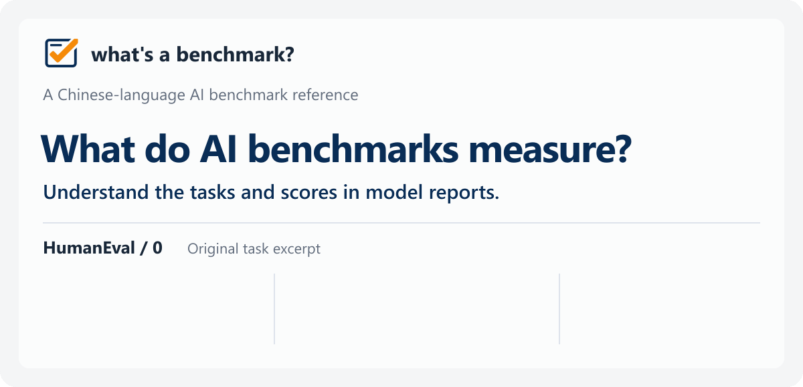
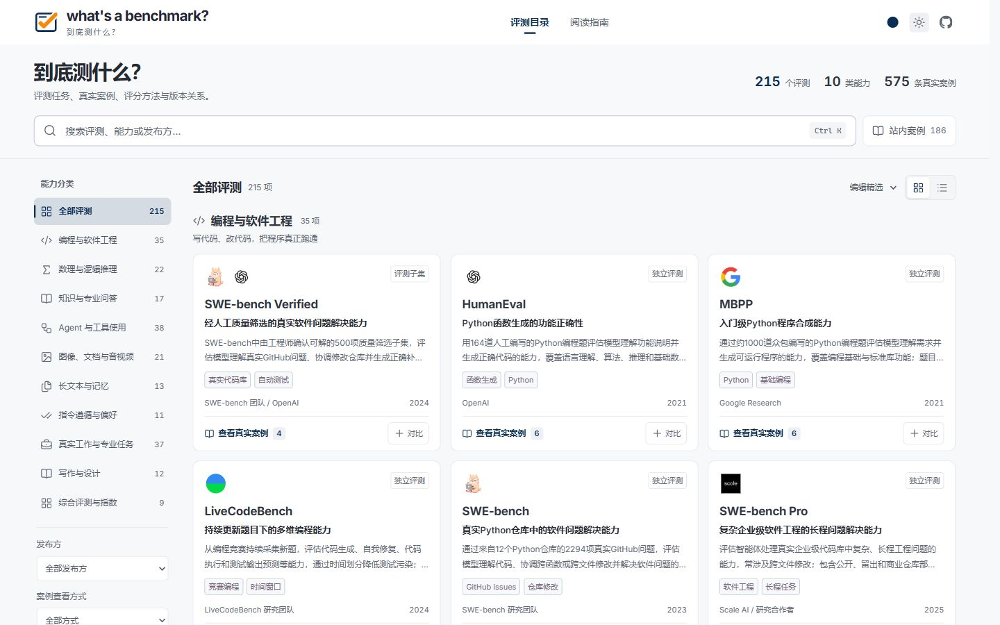
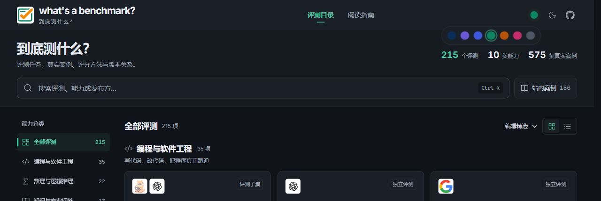
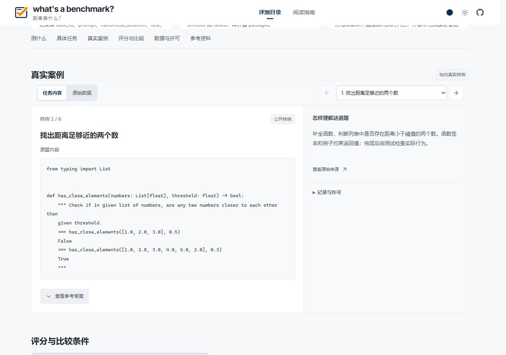

# what's a benchmark?

**A Chinese-language reference for understanding AI and LLM benchmark tasks and the scores in model release reports.**

English · [简体中文](README_ZH.md)

**Website:** [https://whiteplusms.github.io/whats-a-benchmark](https://whiteplusms.github.io/whats-a-benchmark)

  

[Static cover](assets/readme/hero-en.svg)

## Preview

Browse on desktop or mobile, with seven theme colors and light or dark appearance.

Mobile and appearance previews

## About

**what's a benchmark?** organizes task descriptions, public examples, scoring methods, version relationships, and official sources for each evaluation. When reading a model release report, readers can look up a benchmark to understand what a model receives, what it must produce, and the conditions behind the reported score.

The website is currently in **Simplified Chinese**. Original task material retains its source language, with explanations provided by the site. You can browse without signing in.

## Who it is for

AI users reading model reports can find explanations of unfamiliar benchmarks. Developers and product teams can check the capabilities covered and the conditions needed for comparison. Writers and learners can follow entries back to their original sources.

## What readers can learn

- **Tasks and examples:** inspect inputs, expected outputs, and available cases to understand the capabilities being tested. Original material, excerpts, and the site's explanations are labeled separately. Text, code, images, audio, and reference answers depend on the entry.
- **Scores and conditions:** read metric definitions, execution requirements, limitations, and version differences to assess whether two reported results can be compared.
- **Relationships and sources:** distinguish original evaluations, subsets, derivatives, and suites, then follow official papers, project pages, dataset documentation, and model reports.

The catalog supports search by name, capability, or publisher, category filters, and batch lookup of benchmark names. Readers can also compare two or three evaluations side by side and share the comparison URL.

Coverage includes coding, mathematical and logical reasoning, knowledge, agents and tools, multimodal understanding, long context, instruction following, professional work, writing and design, and evaluations spanning multiple capabilities.

## A concrete example

[HumanEval](https://whiteplusms.github.io/whats-a-benchmark/benchmarks/human-eval/) asks models to complete Python functions from signatures and descriptions, then pass unit tests. The HumanEval/0 excerpt in the cover asks whether any two numbers are closer than a given threshold: for `[1.0, 2.0, 3.0]` and a threshold of `0.5`, the example's expected result is `False`.

The entry also explains `pass@k`, sampling and testing conditions, and links to original sources. The example explains the task; the scoring notes help readers interpret the result in a model report.

## Usage

1. Open the [website](https://whiteplusms.github.io/whats-a-benchmark) and search for a benchmark or browse by capability.
2. Open an entry to read its task description, explore available examples, and understand its scoring.
3. Select two or three related benchmarks to compare tasks and evaluation conditions, and copy the comparison URL to share it.
4. Follow the source links for the original material, or use the reading guides to explore further.

## Sources

Descriptions are based on papers, project pages, official repositories, and dataset documentation from benchmark publishers. Model release reports provide references to evaluation use and reported results.

On-site examples depend on public availability and permissions. Each entry explains access conditions and provides official links when needed. The site is a reading and discovery tool: it does not run model evaluations or produce a unified model ranking. Refer to original reports and leaderboards for model scores.

## Contributing

Corrections, suggestions for new benchmarks, and clearer sources are welcome through [GitHub Issues](https://github.com/WhitePlusMS/whats-a-benchmark/issues). Include the benchmark name, the information to add or correct, and an official source link.

Maintained by [WhitePlusMS](https://github.com/WhitePlusMS).

[Logo and brand assets](assets/brand/README.md) · [Screenshots and promotional images](assets/README.md)
