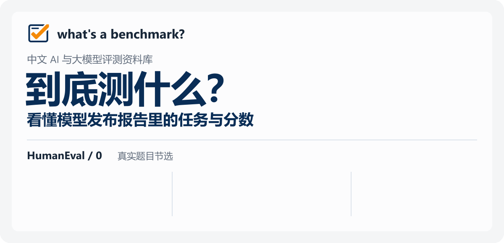

# 到底测什么？

**面向中文读者的 AI 与大模型评测资料库，帮助大家看懂模型发布报告里的任务与分数。**

[English](README.md) · 简体中文

**在线访问：** [https://whiteplusms.github.io/whats-a-benchmark](https://whiteplusms.github.io/whats-a-benchmark)

  

[静态封面](assets/readme/hero.svg)

## 页面预览

支持电脑与手机浏览，可以选择七种主题色和浅色、深色外观。

手机与主题预览

## 项目简介

「到底测什么？」围绕每项评测整理任务说明、可公开样例、评分方法、版本关系与官方来源。阅读模型发布报告的时候，可以从评测名称进入具体任务，了解模型接收什么、需要完成什么，以及分数是在什么条件下得到的。

网站目前使用**简体中文**，原始任务材料保留来源语言，由本站提供解读。阅读无需登录。

## 适合哪些读者

阅读模型发布报告的 AI 使用者，可以从陌生的评测名称找到任务说明；开发者与产品人员，可以核对评测覆盖的能力和比较条件；整理 AI 技术资料的作者与学习者，可以沿着条目查看原始来源。

## 能够了解什么

- **任务与样例**：查看输入、输出要求和可用案例，理解评测考察的能力。原始材料、节选与本站解读分别标注；文本、代码、图片、音频及参考答案按条目提供。
- **评分与条件**：阅读指标含义、运行要求和局限，了解相同名称下的版本差异，判断两份结果是否具备可比较的条件。
- **关系与来源**：区分独立评测、子集、衍生版本和评测体系，继续查阅官方论文、项目主页、数据说明与模型发布资料。

目录支持按名称、能力或发布方搜索、分类筛选，以及粘贴一组评测名称批量查询。也可以选择两到三项评测，并排比较任务、评分方法、版本和限制，分享对比链接。

目录覆盖编程、数理与逻辑推理、知识问答、Agent 与工具使用、多模态理解、长上下文、指令遵循、真实工作、写作与设计，以及综合评测。

## 一个具体例子

[HumanEval](https://whiteplusms.github.io/whats-a-benchmark/benchmarks/human-eval/) 要求模型根据函数签名和说明补全 Python 函数，并通过单元测试。封面使用的 HumanEval/0 节选要求判断一组数字中是否存在距离小于阈值的两个数：输入 `[1.0, 2.0, 3.0]`、阈值 `0.5`，题目给出的预期结果是 `False`。

条目同时说明 `pass@k` 的含义、采样与测试条件，并提供原始资料链接。样例帮助理解任务；评分说明帮助理解模型报告中的结果。

## 使用方式

1. 打开[网站](https://whiteplusms.github.io/whats-a-benchmark)，搜索评测名称或按能力分类浏览。
2. 打开评测详情，阅读任务说明、查看可用样例，了解评分方法。
3. 选择两到三项相关评测，比较任务和评测条件，需要分享时复制对比链接。
4. 沿着来源链接查看原始资料，或通过阅读指南继续了解评测。

## 资料来源

内容依据评测发布者的论文、项目主页、官方仓库和数据说明整理。模型发布报告用于了解评测的采用情况和已报告的结果。

站内样例的展示范围取决于公开程度与许可，各条目会说明获取情况，并在需要时提供官方入口。本站用于阅读与查找资料，不执行模型评测，也不生成统一模型排行榜；模型成绩请以对应的原始报告和榜单为准。

## 参与贡献

欢迎通过 [GitHub Issues](https://github.com/WhitePlusMS/whats-a-benchmark/issues) 纠正解释、补充评测或提供更准确的资料。反馈时请注明评测名称、需要补充或修正的内容，以及对应的官方来源链接。

项目由 [WhitePlusMS](https://github.com/WhitePlusMS) 维护。

[Logo 与品牌素材](assets/brand/README.md) · [页面截图与宣传配图](assets/README.md)
