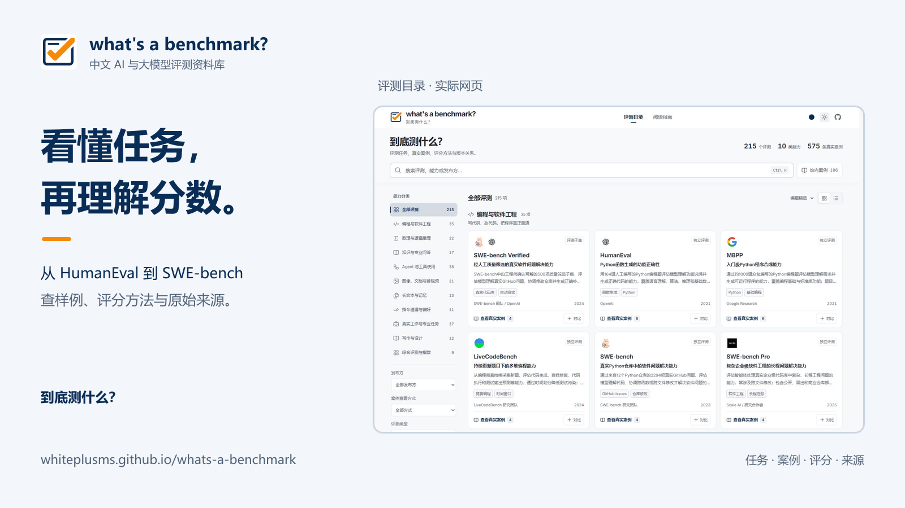

# 项目宣传配图

使用正式蓝橙题卡对号与 2026-10-21 的[实际目录截图](../screenshots/catalog-desktop.png)排版。文字介绍项目的任务、样例、评分说明和来源查询功能。

| 比例 | 可分享 PNG                       | 可编辑 SVG                       | 尺寸      |
| ---- | -------------------------------- | -------------------------------- | --------- |
| 16:9 | [cover-16x9.png](cover-16x9.png) | [cover-16x9.svg](cover-16x9.svg) | 1600×900  |
| 3:4  | [cover-3x4.png](cover-3x4.png)   | [cover-3x4.svg](cover-3x4.svg)   | 1200×1600 |
| 4:3  | [cover-4x3.png](cover-4x3.png)   | [cover-4x3.svg](cover-4x3.svg)   | 1600×1200 |

宣传图含标题与品牌排版，页面部分来自真实截图；4:3 版裁取目录上半部分。需要作为完整页面记录时，请使用[截图目录](../screenshots/README.md)里的原图。图中不包含模型运行结果或统一模型排名。

SVG 内嵌截图，可独立打开编辑。PNG 已导出，分享时优先使用 PNG。文字采用 Microsoft YaHei / Segoe UI，继续编辑时请核对字体。[source-manifest.json](source-manifest.json)记录构图、图源和裁切区域。

旧版生成封面、底图、提示词与生成记录仅保存在本地 `artifacts/archive/2026-10-21-old-brand/`，不上传 GitHub。
