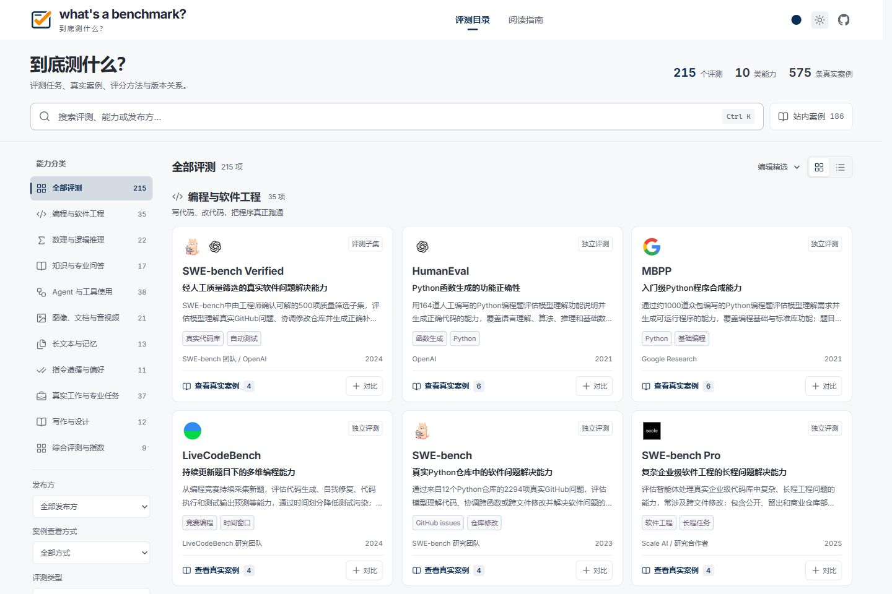
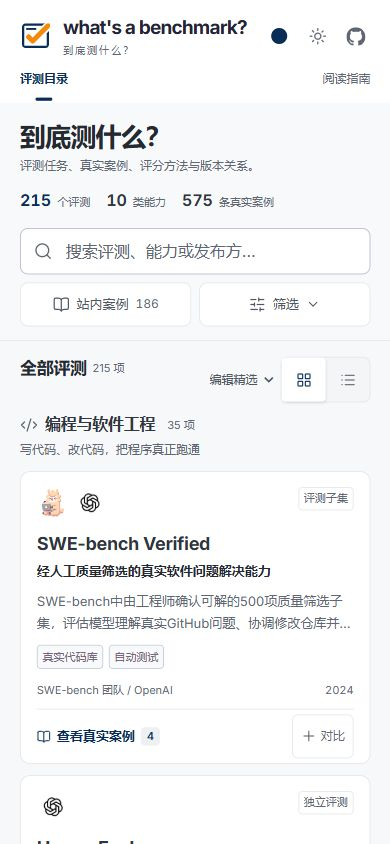
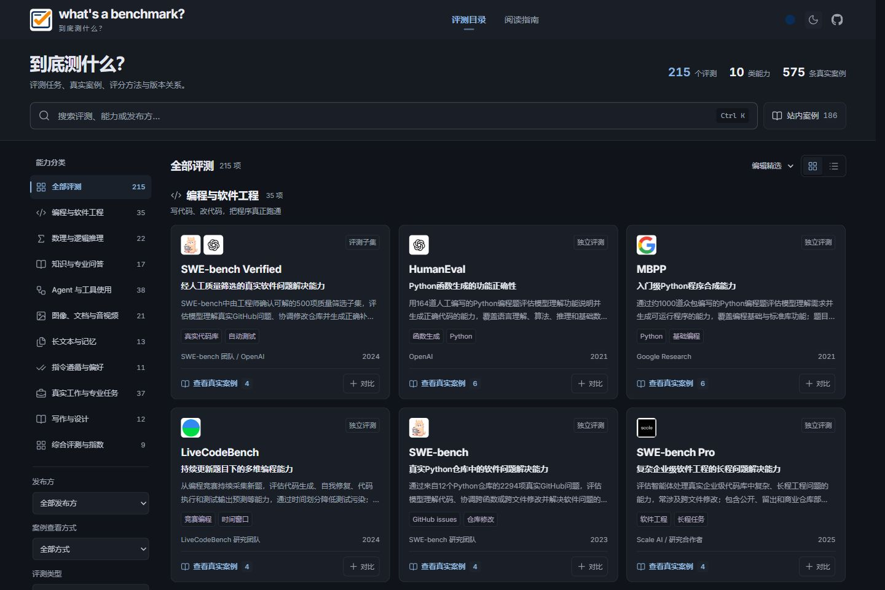

# 当前页面截图

2026-10-21 从[已发布网站](https://whiteplusms.github.io/whats-a-benchmark/)截取。页眉与浏览器标签使用正式题卡对号，界面保留实际内容与发布方标识；截图没有重绘页面。默认使用深海蓝主题，外观见下表。

| 页面或状态                  | 截图                                           | 尺寸     |
| --------------------------- | ---------------------------------------------- | -------- |
| 评测目录                    | [catalog-desktop.png](catalog-desktop.png)     | 1440×960 |
| 列表目录                    | [catalog-list.png](catalog-list.png)           | 1440×960 |
| 手机目录                    | [catalog-mobile.png](catalog-mobile.png)       | 390×844  |
| 深色目录                    | [catalog-dark.png](catalog-dark.png)           | 1440×960 |
| 阅读指南                    | [guide.png](guide.png)                         | 1440×960 |
| HumanEval 详情              | [detail-human-eval.png](detail-human-eval.png) | 1440×960 |
| 代码案例                    | [example-code.png](example-code.png)           | 1440×960 |
| 手机案例                    | [example-mobile.png](example-mobile.png)       | 390×844  |
| ARC-AGI-2 图形案例          | [example-visual.png](example-visual.png)       | 1440×960 |
| 评分与比较条件              | [detail-score.png](detail-score.png)           | 1440×960 |
| 参考资料                    | [detail-sources.png](detail-sources.png)       | 1440×960 |
| DeepSWE v1.1 / DataCurve AI | [detail-deepswe.png](detail-deepswe.png)       | 1440×960 |
| HumanEval 与 MBPP 对比      | [compare.png](compare.png)                     | 1440×960 |
| 发布资料                    | [releases.png](releases.png)                   | 1440×960 |
| 关于与收录规范              | [about.png](about.png)                         | 1440×960 |
| 404 页面                    | [not-found.png](not-found.png)                 | 1440×960 |

手机与深色模式

[capture-manifest.json](capture-manifest.json)记录来源 URL、截取时间、视口、页眉引用、favicon 版本和文件校验值。详情中段截图保留固定页眉，可与原页面对应。截图中的数量与内容属于截取当时的已发布版本，不代表本地未发布改动。

以前的截图和生成封面按原字节保留在本地 `artifacts/archive/2026-10-21-old-brand/`，不上传 GitHub。README 的专用配图继续位于 `../readme/`。
